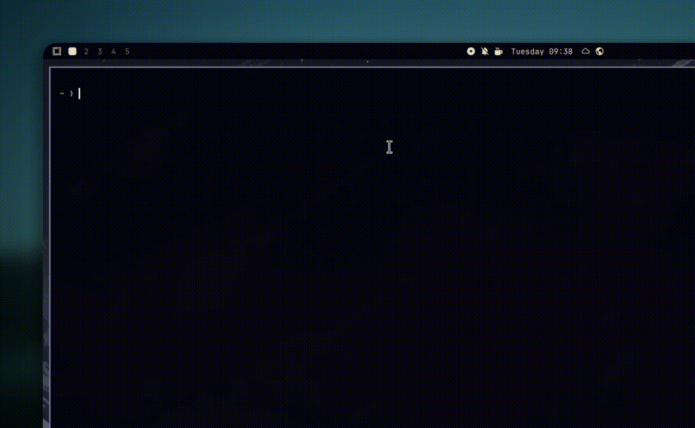

<div align="center">

<br/>
<br/>


# everyFLAC

A terminal downloader for lossless FLAC music. Give it a Spotify or YouTube Music link, or a plain search query, and it downloads the audio and writes the tags and cover art into the FLAC file.



Runs on Linux and Windows 10/11. No account or API key needed.

[](https://go.dev)
[](#)
[](LICENSE)

</div>

## Install

### Linux

```bash
curl -fsSL https://raw.githubusercontent.com/pxradiso/everyflac/main/setup.sh | bash
```

The script installs `yt-dlp` and `ffmpeg` if they are missing, puts the `everyflac` binary in `~/.local/bin`, adds an `everyFLAC` entry to your application menu (it opens in a terminal), and adds `~/.local/bin` to your shell `PATH`.

If you prefer to clone the repo:

```bash
git clone https://github.com/pxradiso/everyflac.git
cd everyflac
./setup.sh
```

### Windows 10/11

Download [`setup.exe`](setup.exe) and run it. It already contains everyFLAC, `yt-dlp.exe` and `ffmpeg.exe`, so there is nothing else to download.

The installer:

- installs to `%LOCALAPPDATA%\Programs\everyFLAC`;
- adds an everyFLAC shortcut to the Start Menu;
- optionally adds a desktop shortcut (tick the box during setup);
- adds the install folder to your user `PATH`;
- registers an uninstaller in Settings → Apps.

The shortcuts open everyFLAC in a Command Prompt window.

The installer is not code-signed, so SmartScreen may warn you. Choose **More info → Run anyway**.

`setup.bat` is a portable alternative that installs to `%USERPROFILE%\.local\bin` without the installer UI. `setup.ps1` runs the same script from PowerShell.

### macOS

macOS builds are not available right now.

## Updates

everyFLAC checks for a new version when the TUI starts, at most once every 24 hours. If one is available, the header shows `update vX.Y.Z`. If you are already on the latest version, the help panel (`Ctrl+H`) shows `up to date`. It does not update itself.

You can force a check at any time:

```bash
everyflac --check-update
```

To update, run the installer again. Your settings are kept:

- Windows: run the new `setup.exe`.
- Linux: re-run the curl command.

The check can be disabled with `EVERYFLAC_NO_UPDATE_CHECK=1`.

## Usage

Run `everyflac` to open the TUI. Paste a link or type a search query.

You can also run it directly:

```bash
# Spotify track, album or playlist
everyflac "https://open.spotify.com/track/4cOdK2wGLETKBW3PvgPWqT"

# YouTube Music
everyflac "https://music.youtube.com/watch?v=k4V3Mo61fJM"

# Search and download the first match
everyflac "Daft Punk Get Lucky"

# Force YouTube Music for a Spotify link
everyflac -m youtube "https://open.spotify.com/track/..."

# Custom output directory
everyflac "Coldplay Yellow" -o ~/Music/Favorites
```

### Options

| Flag | Description |
| --- | --- |
| `-o`, `-output` | Output directory (default `~/Music`) |
| `-m`, `-mode` | Engine: `auto`, `spotify`, `youtube` |
| `-s`, `-search` | Search and download the first match |
| `-u`, `-url` | Download a URL without opening the TUI |
| `-v`, `-version` | Print the version |
| `--check-update` | Check for a newer release and exit |
| `--remove` | Uninstall everyFLAC |
| `-y`, `-yes` | Skip the uninstall confirmation |

## Keyboard shortcuts

| Key | Action |
| --- | --- |
| `Enter` | Download the current input |
| `Tab` / `Shift+Tab` | Switch between Queue and Library |
| `Ctrl+1` / `Ctrl+2` | Switch to Spotify / YouTube Music (Linux) |
| `Alt+1` / `Alt+2` or `F1` / `F2` | Switch to Spotify / YouTube Music (Windows) |
| `Ctrl+T` | Toggle the engine |
| `Ctrl+D` | Change the destination folder |
| `Ctrl+O` | Open the destination folder |
| `Ctrl+A` | Toggle visual effects |
| `Ctrl+H` | Show help |
| `Ctrl+C` | Quit |
| `Esc` | Unfocus the input or close help |
| `i` or `/` | Focus the input |
| `a`, `o`, `q`, `?` | Same actions when the input is not focused |

On Windows, `Ctrl+1`/`Ctrl+2` are captured by the terminal (Windows Terminal uses them to switch tabs) and the console API does not report them to the app. Use `Alt+1`/`Alt+2` or `F1`/`F2` there.

## Uninstall

```bash
everyflac --remove
```

Or without confirmation:

```bash
everyflac --remove -y
```

With the setup script:

```bash
./setup.sh --remove
```

## Binaries

Pre-built binaries are in `bin/`:

| Platform | Architecture | File |
| --- | --- | --- |
| Windows | amd64 + arm64 | [`setup.exe`](setup.exe) |
| Windows | x86_64 | [`bin/everyflac-tui-windows-amd64.exe`](bin/everyflac-tui-windows-amd64.exe) |
| Windows | ARM64 | [`bin/everyflac-tui-windows-arm64.exe`](bin/everyflac-tui-windows-arm64.exe) |
| Linux | x86_64 | [`bin/everyflac-tui-linux-amd64`](bin/everyflac-tui-linux-amd64) |
| Linux | aarch64 | [`bin/everyflac-tui-linux-arm64`](bin/everyflac-tui-linux-arm64) |

## Configuration

Settings are stored in:

- Linux: `~/.config/everyflac/config.json`
- Windows: `%AppData%\everyflac\config.json`

```json
{
  "output_dir": "/home/user/Music",
  "create_artist_folder": false,
  "create_album_folder": false,
  "preferred_quality": "FLAC_24BIT",
  "embed_lyrics": true,
  "source_mode": "spotify",
  "qobuz_mirrors": [],
  "tidal_mirrors": []
}
```

You normally don't need to edit this file. The TUI writes it when you change settings.

## Build from source

Requires Go 1.27 or newer, plus `ffmpeg` and `yt-dlp` at runtime.

```bash
git clone https://github.com/pxradiso/everyflac.git
cd everyflac
go build -ldflags="-s -w" -o everyflac .
./everyflac
```

## Disclaimer

everyFLAC is meant for personal archival and educational use. It downloads audio from publicly available streams and does not bypass DRM. If you like the music, buy it.
