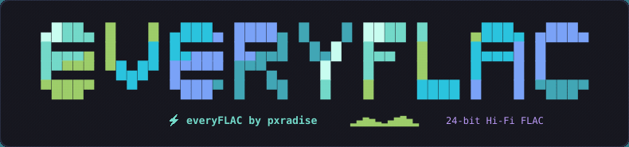

<div align="center">

  

### ⚡ everyFLAC by pxradise

**The All-in-One Lossless FLAC Music Downloader & Interactive Terminal Workstation**

[](https://golang.org)
[](https://img.shields.io/badge/Platform-Linux%20|%20macOS%20|%20Windows-7aa2f7?style=for-the-badge&logo=linux)
[](https://github.com)
[](LICENSE)
[](https://github.com)

<p align="center">
  <b>True Lossless Studio Sound (24-bit / 96kHz & 16-bit / 44.1kHz)</b><br>
  Download from <b>Spotify</b>, <b>YouTube Music</b>, <b>YouTube</b>, or <b>direct search</b> with <b>zero accounts, zero cookies, and zero telemetry</b>.
</p>

</div>

---

## ✨ Features

- 🎧 **Authentic Lossless FLAC**  
  Streams directly in pristine **24-bit / 48–96kHz** Studio Quality or **16-bit / 44.1kHz** CD Quality. No fake upscaling or lossy transcoding.
- 🔄 **Dual Engine Architecture**  
  Seamlessly toggle between **Spotify Engine** (`[F1]`) and **YouTube Music Engine** (`[F2]`) on the fly, or let the Auto-Engine pick the best lossless source.
- 🎨 **Clean Tags & Embedded Artwork**  
  High-resolution front covers are encoded in-memory and injected directly into FLAC `METADATA_BLOCK_PICTURE`. Complete VorbisComment tagging (Title, Artist, Album, Year, Track Number, ISRC). **No loose `cover.jpg` files cluttering your folders**.
- 📁 **Direct-to-Music Storage**  
  Downloads go directly into your `~/Music` folder (`C:\Users\<user>\Music` on Windows) without redundant nested folders. Easily change your folder anytime with `[Ctrl+D]`.
- 🔓 **Fully Open-Source**  
  100% free and open-source software (FOSS). Transparent, community-driven, with zero telemetry, zero tracking, and no subscriptions.
- 🪟 **100% Cross-Platform & Windows 10/11 Optimized**  
  Engineered specifically to eliminate Windows console glyph errors (encoding fallbacks for Consolas/cmd.exe, anti-overflow vertical sizing, zero ghost lines).
- 🚀 **1-Click Self-Contained Installers**  
  Automatic dependency management: installs `yt-dlp` and `ffmpeg` with live download and extraction progress bars if missing.

---

## 🚀 Quick Start & Installation

### 🐧 Linux & 🍎 macOS (1-Click Installer)

Clone the repository and run the setup script:

```bash
git clone https://github.com/pxradise/everyflac-tui.git
cd everyflac-tui
chmod +x ./setup.sh
./setup.sh
```

> **What it does:** Automatically detects your package manager (`pacman`, `apt`, `dnf`, `zypper`, `apk`, `xbps`, `brew`), verifies `ffmpeg` and `yt-dlp`, installs the `everyflac` binary to `~/.local/bin`, and configures your shell `$PATH` (`.bashrc`, `.zshrc`, `config.fish`).

---

### 🪟 Windows 10 & 11 (1-Click Installer)

Open **PowerShell** or simply double-click **`setup.bat`**:

```powershell
cd everyflac-tui
.\setup.ps1
```

> **What it does:**
> - Verifies or automatically downloads standalone `yt-dlp.exe` and `ffmpeg.exe` with real-time download and extraction progress bars.
> - Installs `everyflac.exe` to `%USERPROFILE%\.local\bin` and permanently updates your User `PATH`.
> - 100% 7-bit ASCII safe (bypasses Windows PowerShell 5.1 quote bugs and execution policy restrictions).

---

## 💻 Usage

### 1. Interactive Terminal UI (TUI)

Launch the full interactive TUI:

```bash
everyflac
```
*(Or use `everyflac-tui` or `pxradise-everyflac`)*

- Paste any Spotify track, album, or playlist link.
- Paste any YouTube Music track or album link.
- Or simply type a search query: `Kendrick Lamar Not Like Us` or `Dua Lipa Levitating`.

---

### 2. Fast CLI / Headless Mode

Download directly from your terminal without opening the interactive UI:

```bash
# Download a Spotify track, album, or playlist
everyflac "https://open.spotify.com/track/4cOdK2wGLETKBW3PvgPWqT"

# Download from YouTube Music
everyflac "https://music.youtube.com/watch?v=k4V3Mo61fJM"

# Direct search and download top match
everyflac "Daft Punk Get Lucky"

# Force YouTube Music engine for a Spotify link
everyflac -m youtube "https://open.spotify.com/track/..."

# Custom output destination
everyflac "Coldplay Yellow" -o ~/Music/Favorites
```

---

## ⌨️ Keyboard Shortcuts (TUI)

| Key | Action |
| :--- | :--- |
| `[Enter]` | Start resolving & downloading input query |
| `[Tab]` | Switch to next tab (**Queue** ➔ **Library** ➔ **Logs**) |
| `[Shift+Tab]` | Switch to previous tab |
| `[F1]` / `[Alt+1]` | Switch to **Spotify Engine** |
| `[F2]` / `[Alt+2]` | Switch to **YouTube Music Engine** |
| `[Ctrl+T]` / `[S]` | Toggle source engine (**Spotify** ⇄ **YouTube Music**) |
| `[1, 2, 3]` | Jump directly to tab: `1` Queue, `2` Library, `3` Logs |
| `[Ctrl+L]` | Jump directly to **Engine Logs** |
| `[Ctrl+D]` | Set custom destination directory (persisted permanently) |
| `[A]` / `[Ctrl+A]` | Toggle **Omarchy Animated Equalizer & Visual FX** |
| `[O]` | Open destination directory in system file manager |
| `[I]` or `/` | Focus search / URL input box |
| `[Esc]` | Unfocus input box / Dismiss modals |
| `[?]` / `[H]` | Open interactive Help modal |
| `[Q]` | Quit application |

---

## 📦 Pre-compiled Standalone Binaries (in `bin/`)

Ready-to-run binaries are provided in the `bin/` directory for immediate use without needing Go installed:

| Platform | Architecture | Binary Path |
| :--- | :--- | :--- |
| **Linux** | `x86_64` (AMD64) | [`bin/everyflac-tui-linux-amd64`](bin/everyflac-tui-linux-amd64) |
| **Linux** | `aarch64` (ARM64) | [`bin/everyflac-tui-linux-arm64`](bin/everyflac-tui-linux-arm64) |
| **macOS** | Apple Silicon (`M1/M2/M3/M4`) | [`bin/everyflac-tui-darwin-arm64`](bin/everyflac-tui-darwin-arm64) |
| **macOS** | Intel (`x86_64`) | [`bin/everyflac-tui-darwin-amd64`](bin/everyflac-tui-darwin-amd64) |
| **Windows** | `x86_64` (64-bit) | [`bin/everyflac-tui-windows-amd64.exe`](bin/everyflac-tui-windows-amd64.exe) |

---

## ⚙️ Configuration

Configuration is stored permanently in JSON format:
- **Linux/macOS:** `~/.config/everyflac/config.json`
- **Windows:** `%USERPROFILE%\.config\everyflac\config.json`

```json
{
  "output_dir": "~/Music",
  "source_mode": "auto",
  "preferred_quality": "FLAC_24BIT",
  "embed_cover_art": true,
  "embed_metadata": true
}
```

---

## 🛠️ Building from Source

Requirements: **Go 1.21+**, **ffmpeg**, and **yt-dlp**.

```bash
# Clone the repository
git clone https://github.com/pxradise/everyflac-tui.git
cd everyflac-tui

# Build optimized binary
go build -ldflags="-s -w" -o everyflac main.go

# Run
./everyflac
```

---

## ⚖️ Disclaimer

`everyFLAC` is designed for personal archival and educational purposes. All audio is fetched from publicly available media streams without bypassing DRM. Please support the artists by purchasing their music, official vinyls, and concert tickets.

---

<div align="center">
  <b>Crafted with ❤️ by pxradise</b><br>
  <sub>Powered by Go • Charmbracelet Bubbletea • Lipgloss • yt-dlp • FFmpeg</sub>
</div>
